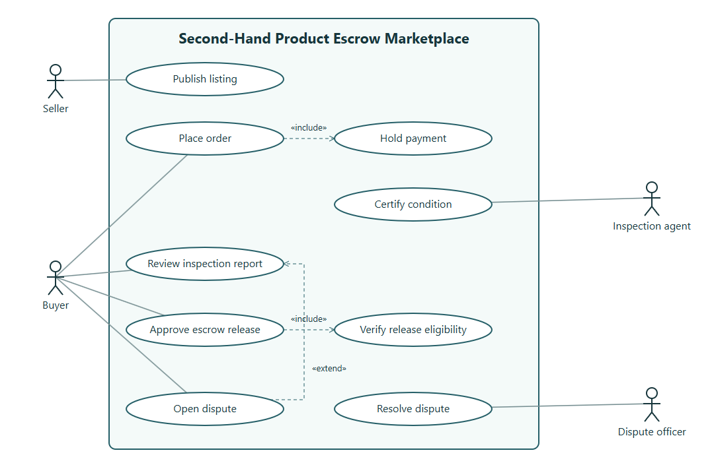

# Second-Hand Product Escrow Marketplace

Ganavi Purushothama · PES2UG24CS167  
PES University · Software Engineering Lab 1 · Problem Statement #39

Buyer payments stay in escrow while an independent agent checks the item. Seller payout requires successful inspection and buyer sign-off. An open dispute freezes the hold.

- [Assigned problem](docs/39_SE_Lab1_SE_Problem_Statements.pdf)
- [Requirements source](requirements/requirements.md) and [PDF](submission/PES2UG24CS167_Requirements_Table.pdf)
- [Editable UML](uml/use-case-diagram.drawio) and [PDF](submission/PES2UG24CS167_UML_Use_Case.pdf)
- [Use-case flow source](use-case-flow/approve-escrow-release.md) and [one-page PDF](submission/PES2UG24CS167_Use_Case_Flow.pdf)

